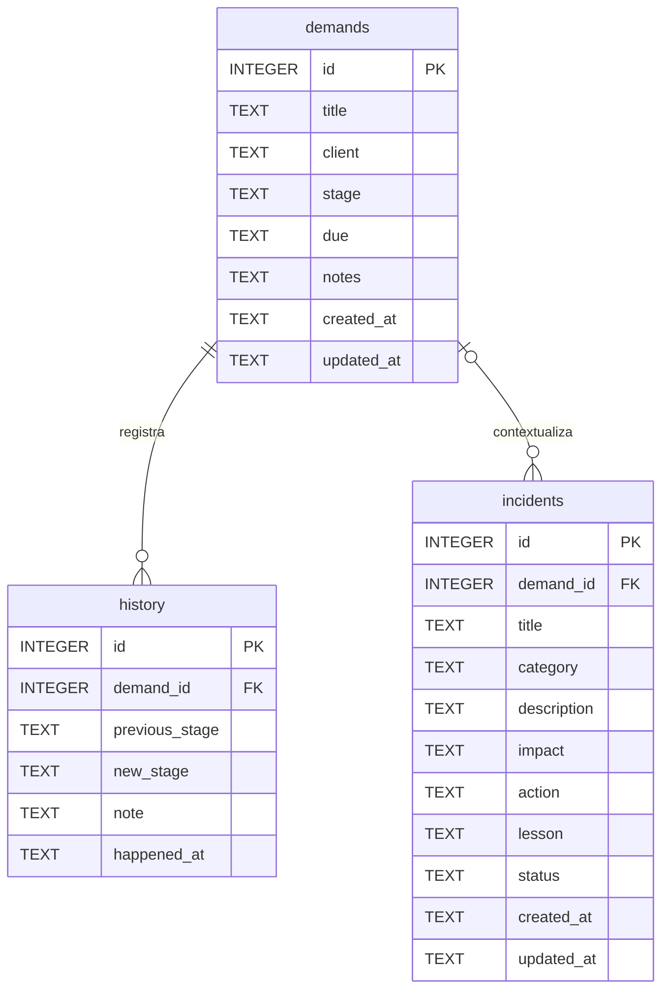

# Modelo de dados do Módulo 3

O sistema acompanha demandas e ocorrências de ética digital de um usuário local. O esquema executável está em `sql/schema.sql`, carregado por `app.py` e pela demonstração do módulo. A senha e o segredo de sessão permanecem fora do banco, em configuração local não versionada.

## Entidades e dicionário

| Entidade | Campos e significado | Restrições |
| --- | --- | --- |
| demands | id; title e client (até 120 caracteres na aplicação); stage (sete etapas); due (data ISO); notes (até 2000); created_at e updated_at (instantes UTC ISO) | id PK; demais NOT NULL; notes padrão vazio |
| history | id; demand_id; previous_stage (pode ser NULL na criação); new_stage; note; happened_at | id PK; demand_id NOT NULL e FK para demands; demais NOT NULL exceto previous_stage |
| incidents | id; demand_id opcional; title (120); category; description, impact, action e lesson (2000); status; created_at e updated_at | id PK; demand_id FK anulável; demais NOT NULL; action e lesson padrão vazio |

Uma demanda possui zero ou muitos eventos e incidentes. Cada evento pertence obrigatoriamente a uma demanda. Cada incidente pode referenciar zero ou uma demanda. As chaves são inteiras e geradas pelo SQLite quando omitidas. Sem AUTOINCREMENT, a reutilização de IDs excluídos é possível; IDs não são identificadores públicos permanentes.

O banco assegura PK, NOT NULL e integridade referencial. `PRAGMA foreign_keys=ON` é aplicado em cada conexão. A ação padrão NO ACTION impede remover uma demanda enquanto existirem dependentes. Não há cascata de exclusão. Os índices `idx_history_demand` e `idx_incidents_demand` apoiam a pesquisa pelos vínculos, sem afirmar ganho de tempo medido.

## Normalização e limites

Os campos armazenam valores escalares, sem listas de eventos dentro da demanda. As três tabelas têm chave simples, evitando dependências parciais. Cada evento e cada incidente possui atributos próprios; os dados descritivos da demanda são consultados por JOIN. O campo client é um rótulo de referência, sem cadastro separado ou dados de contato. Criar entidade de cliente só se justifica quando houver atributos e operações próprios.

A etapa anterior e a nota em history são registros de acontecimentos passados. Sua repetição em relação ao estado atual é deliberada para rastreabilidade. Este histórico não é uma trilha completa de todas as alterações: mudança apenas de título, cliente ou prazo não cria evento; incidentes não têm versionamento de conteúdo.

Limites de texto, listas de etapas/categorias, validade de datas e ação/lição obrigatórias no encerramento são validados pelo servidor Flask. Não foram adicionados CHECKs ao banco: SQL externo precisa obedecer a essas regras e pode gravar valores de domínio que o formulário rejeitaria. A documentação distingue integridade estrutural de validação de negócio.

## Compatibilidade

O M3 extrai o esquema antes embutido em app.py, sem renomear tabelas ou colunas. CREATE TABLE/INDEX IF NOT EXISTS permite reabertura sem apagar dados e acrescenta os dois índices a bases preexistentes. Isso não é um mecanismo geral de migração; mudanças futuras de colunas exigirão scripts versionados e backup prévio.
